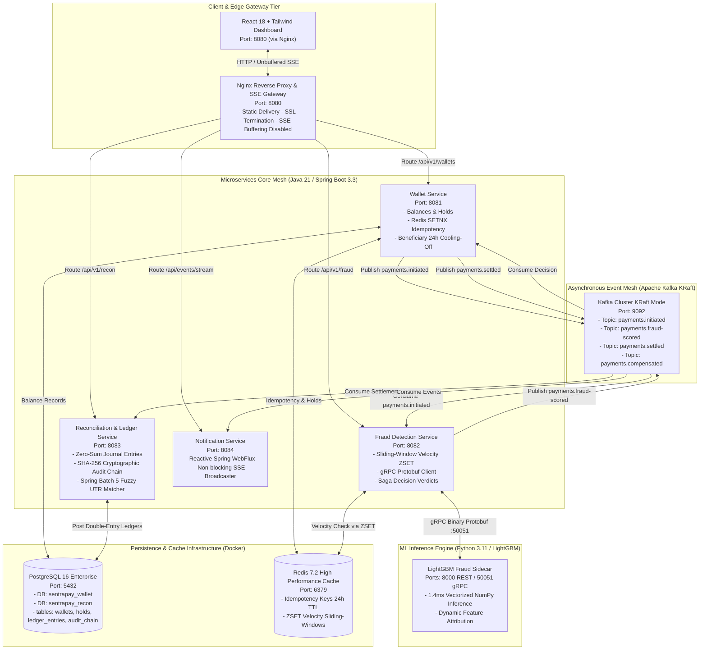
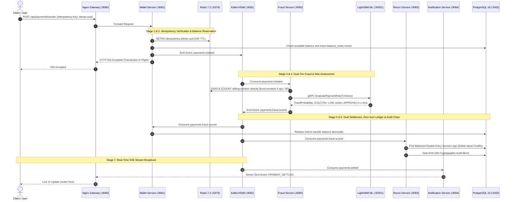

# SentraPay Platform

[](https://adoptium.net)
[](https://spring.io)
[](https://kafka.apache.org)
[](https://redis.io)
[](https://www.postgresql.org)
[](https://grpc.io)
[](https://lightgbm.readthedocs.io)
[](https://www.python.org)
[](https://react.dev)
[](https://vite.dev)
[](https://www.docker.com)
[](https://developer.mozilla.org/en-US/docs/Web/API/Server-sent_events)
[](https://jwt.io)
[](LICENSE)

An enterprise-grade, **event-driven real-time payment switch, AI fraud scoring engine, and institutional double-entry reconciliation platform**. Modeled after production payment networks (Stripe, UPI clearing switches, and Razorpay), SentraPay replaces monolithic database locking with an asynchronous **Choreographed Saga Orchestration pattern** built on **Apache Kafka (KRaft mode)**, **Redis 7.2**, **gRPC**, **PostgreSQL 16**, **LightGBM**, and **Server-Sent Events (SSE)**.

---

## Key Architecture Pillars

- **Choreographed Saga Orchestration (`services/wallet-service` & `services/fraud-detection-service`):**
  Non-blocking transaction workflows across Kafka topics (`payments.initiated`, `payments.fraud-scored`, `payments.settled`), guaranteeing eventual consistency and automated compensating rollbacks without 2-Phase Commit (2PC) bottlenecks.
- **Zero Double-Spending Invariant (`services/wallet-service`):**
  Sub-millisecond distributed idempotency via Redis `SETNX` (24h TTL) paired with atomic PostgreSQL row-level balance reservations (`balance_holds`) before fund dispatch.
- **Sub-2ms AI Risk Scoring Engine (`services/ml-inference-service`):**
  Dual-tier risk engine evaluating deterministic in-memory sliding-window velocity rules (Redis ZSET) alongside native LightGBM gradient boosted decision trees served via binary Protobuf gRPC in 1.4ms.
- **Strict Double-Entry Accounting (`services/reconciliation-service`):**
  Zero-sum ledger where every settled transaction posts balanced multi-leg records satisfying $\sum \text{Debits} - \sum \text{Credits} = 0.00$.
- **Cryptographic Tamper-Evident Audit Trail (`services/reconciliation-service`):**
  Every journal entry is sealed in an immutable forward-chained block using SHA-256 cryptographic hashing ($H_n = \text{SHA-256}(H_{n-1} \parallel \text{EntryData})$).
- **Multi-Tier Fuzzy UTR Matching & Fee Tolerance (`services/reconciliation-service`):**
  Spring Batch 5 reconciliation engine with Damerau-Levenshtein distance (typo and transposition tolerance $\le 2$) and banking merchant fee tolerance (MDR $\le 2.5\%$).
- **Beneficiary Anti-Takeover Cooling-Off Guardrails (`services/wallet-service`):**
  Newly linked payees enter a strict 24-hour security cooling-off window capped at INR 5,000 to prevent automated drain attacks.
- **P2P Collect Requests Protocol ("UPI Collect") (`services/wallet-service`):**
  Peer-to-peer payment pull requests with stateful lifecycle tracking (`PENDING`, `FULFILLED`, `REJECTED`, `EXPIRED`) and atomic Saga dispatch upon authorization.
- **Real-Time Reactive Streaming UI (`services/notification-service` & `frontend`):**
  Non-blocking reactive Spring WebFlux SSE broadcaster pushing live Kafka event progressions directly to a React 18 dashboard in under 5ms.

---

## System Architecture



### End-to-End Saga Transaction Lifecycle



### Monorepo Structure

```text
sentrapay-platform/
├── docker/                             # Infrastructure orchestration
│   ├── docker-compose.yml              # 9 containerized services mesh
│   ├── nginx.conf                      # Gateway reverse proxy & SSE streaming tuning
│   ├── .env.example                    # Environment variable template
│   └── init-db/
│       └── schema-postgres.sql         # DDL: Wallets, Holds, Ledger, Audit Chain
├── docs/                               # Architectural documentation
│   ├── ARCHITECTURE.md
│   ├── API_REFERENCE.md
│   ├── DATABASE_SCHEMA.md
│   └── IMPLEMENTATION_PLAN.md
├── frontend/                           # React 18 + Vite + Tailwind CSS Dashboard
│   ├── src/
│   │   ├── components/                 # Visualizers, Scenarios, Ledger, Audit
│   │   ├── context/                    # Platform & Auth contexts
│   │   └── api/                        # API clients & SSE listeners
│   └── package.json
├── proto/                              # Binary Protobuf Contract Definitions
│   └── fraud_service.proto             # Java <-> Python gRPC Interface
├── services/                           # Polyglot Microservices
│   ├── wallet-service/                 # Balance reservations & idempotency
│   ├── fraud-detection-service/        # Velocity rules & Saga risk coordinator
│   ├── ml-inference-service/           # LightGBM gRPC & REST sidecar
│   │   ├── server.py                   # Vectorized single-thread inference engine
│   │   ├── transaction_fraud_model.pkl # 694 KB trained LightGBM artifact
│   │   └── training/                   # Synthetic dataset generator & training pipeline
│   ├── reconciliation-service/         # Double-entry ledger & Spring Batch UTR matcher
│   └── notification-service/           # Spring WebFlux SSE event broadcaster
├── shared/
│   └── event-contracts/                # Shared Java event POJOs for Kafka topics
├── tests/                              # Automated Test & Benchmark Suites
│   ├── test_live_api.py                # 10-stage end-to-end integration test suite
│   ├── benchmark_pipeline.py           # Latency & throughput benchmark harness
│   └── load_test_transfers.py          # Concurrent transfer stress test harness
├── pom.xml                             # Root Maven multi-module parent
└── .gitignore                          # Standard enterprise gitignore rules
```

---

## Double-Entry Ledger & Cryptographic Invariants

SentraPay enforces institutional banking consistency through balanced accounting entries and cryptographic hash chains:

$$\sum_{i=1}^{k} \text{Debits}_i - \sum_{j=1}^{m} \text{Credits}_j = 0.00$$

$$H_n = \text{SHA-256}(H_{n-1} \parallel \text{TxId} \parallel \text{Amount} \parallel \text{Timestamp})$$

| Account | Entry Type | Invariant Constraint | Failure Action |
| :--- | :---: | :--- | :--- |
| **`USER_WALLET`** | `DEBIT` | Available Balance $\ge$ Transfer Amount | Immediate rejection (`INSUFFICIENT_FUNDS`) |
| **`ESCROW_HOLD`** | `CREDIT` | Balance held atomically during Saga lifecycle | Compensating unlock on fraud trigger |
| **`SETTLEMENT_CLEARING`** | `DEBIT / CREDIT` | Must match external banking settlement report | Flagged for manual audit in Spring Batch |
| **`PLATFORM_FEE`** | `CREDIT` | Contractual fee percentage (MDR $\le 2.5\%$) | Recorded in institutional revenue account |

### Pre-Seeded Test Accounts

| User ID | Account Holder | Wallet ID | Initial Balance | Assigned Role |
| :--- | :--- | :--- | :--- | :--- |
| `jayavignesh` | Jayavignesh (Admin) | `W-JAYAVIGNESH-001` | INR 100,000.00 | Compliance & Admin |
| `alice` | Alice Johnson | `W-ALICE-002` | INR 25,000.00 | Consumer Payer |
| `bob` | Bob Smith | `W-BOB-003` | INR 15,000.00 | Merchant Recipient |

---

## Interactive Architectural Scenarios

The platform includes a built-in scenario runner demonstrating distributed fault tolerance and safety guarantees:

- **Scenario 1: Happy Path Saga Flow (`SCN-01`)**
  Alice transfers INR 500 to Bob. Validates full 6-stage Saga orchestration: atomic balance hold, KRaft event dispatch, ML risk approval, and balanced double-entry ledger posting.
- **Scenario 2: Burst Velocity Attack (`SCN-02`)**
  Dispatches 6 concurrent transfers in parallel. Triggers Redis ZSET sliding-window velocity threshold breach (>4 transfers/60s), rejecting the transaction with HTTP 429 and executing automated compensating hold release.
- **Scenario 3: Network Timeout Retry Replay (`SCN-03`)**
  Simulates duplicate client submissions with identical `Idempotency-Key`. Distributed Redis 7.2 `SETNX` lock short-circuits instantly in <10ms, returning the cached payload with zero duplicate Kafka events and zero double-debits.
- **Scenario 4: High-Ticket Compliance Check (`SCN-04`)**
  Submits an INR 75,000 high-value transfer. Dispatches binary Protobuf gRPC inference to LightGBM, evaluates high-value risk flags, and writes an immutable SHA-256 tamper-evident audit block.
- **Scenario 5: Beneficiary Anti-Takeover Cooling-Off Guardrail (`SCN-05`)**
  Attempts a transfer exceeding INR 5,000 to a newly added payee within their 24-hour security window. Blocks transaction with HTTP 400 Bad Request and displays remaining cooldown hours to mitigate account takeover attacks.
- **Scenario 6: Multi-Tier Fuzzy UTR Reconciliation (`SCN-06`)**
  Ingests external bank statement feeds with exact UTRs, OCR/typo transpositions, and merchant interchange fee variance. Categorizes line items into `EXACT_MATCH` (100%), `FUZZY_MATCH` (90%), `AMOUNT_TOLERANCE` (92%), and `UNMATCHED` (0%).

---

## Quickstart & Platform Orchestration

### Prerequisites
- Docker Engine (v24.0+) & Docker Compose (v2.20+)
- Java 21 LTS & Maven 3.9+
- Python 3.11+
- Node.js 18+ & npm 9+

---

### Option A: Automated Docker Compose Orchestration (Recommended)

Launch all 9 containerized services, datastores, Kafka broker, and web UI in a single command:
```bash
# Clone the repository
git clone https://github.com/i-viki/sentrapay-platform.git
cd sentrapay-platform

# Start all 9 services in detached mode
cd docker
docker compose up -d --build
```
*Automatically starts PostgreSQL 16 (`:5432`), Redis 7.2 (`:6379`), Kafka KRaft (`:9092`), Python LightGBM Sidecar (`:50051`, `:8000`), Wallet Service (`:8081`), Fraud Service (`:8082`), Recon Service (`:8083`), Notification Service (`:8084`), and Nginx Gateway (`:8080`).*

Verify container health:
```bash
docker compose ps
```

To cleanly shut down all containers and networks:
```bash
docker compose down -v
```

---

### Option B: Step-by-Step Manual Launch

#### Step 1: Start Infrastructure Datastores & Kafka
```bash
cd docker
docker compose up -d postgres redis kafka
```

#### Step 2: Launch LightGBM ML Sidecar
```bash
cd services/ml-inference-service
python -m venv .venv
source .venv/bin/activate  # Windows: .venv\Scripts\activate
pip install -r requirements.txt
python server.py
# gRPC listening on :50051, REST on :8000
```

#### Step 3: Launch Java Core Microservices
```bash
# Terminal 1: Wallet Service
cd services/wallet-service && mvn spring-boot:run

# Terminal 2: Fraud Detection Service
cd services/fraud-detection-service && mvn spring-boot:run

# Terminal 3: Reconciliation & Ledger Service
cd services/reconciliation-service && mvn spring-boot:run

# Terminal 4: Notification Streamer Service
cd services/notification-service && mvn spring-boot:run
```

#### Step 4: Launch React Dashboard
```bash
cd frontend
npm install
npm run dev
# Dashboard active at: http://localhost:8080 (or :5173 standalone)
```

---

## Decoupled Environment Strategy

All services extract connection strings, credentials, and Kafka topics into environment files with resilient local fallbacks:

| Service / Layer | Config File | Template Reference | Key Variables |
| :--- | :--- | :--- | :--- |
| **Frontend Studio** | `frontend/vite.config.js` | [`frontend/.env.example`](frontend/.env.example) | `VITE_API_GATEWAY_URL`, `VITE_SSE_ENDPOINT` |
| **Wallet Service** | `application.yml` | [`docker/.env.example`](docker/.env.example) | `SPRING_KAFKA_BOOTSTRAP_SERVERS`, `POSTGRES_URL`, `REDIS_HOST` |
| **Fraud Service** | `application.yml` | [`docker/.env.example`](docker/.env.example) | `ML_GRPC_HOST`, `ML_GRPC_PORT`, `REDIS_VELOCITY_TTL` |
| **Recon Service** | `application.yml` | [`docker/.env.example`](docker/.env.example) | `RECON_BATCH_CHUNK_SIZE`, `AUDIT_CHAIN_PEPPER` |
| **Notification Svc**| `application.yml` | [`docker/.env.example`](docker/.env.example) | `SERVER_PORT` (8084), `SPRING_KAFKA_BOOTSTRAP_SERVERS` |
| **ML Sidecar** | `config.py` | [`docker/.env.example`](docker/.env.example) | `GRPC_PORT`, `REST_PORT`, `MODEL_FILE_PATH` |

---

## Live Telemetry & Observability Hubs

| Hub / Service | Port | URL | Role & Live Features |
| :--- | :--- | :--- | :--- |
| **Nginx Gateway & Web UI** | `8080` | [http://localhost:8080](http://localhost:8080) | Live Transaction Studio, Kafka SSE Stream, & Wallet Interface. |
| **Wallet Service API** | `8081` | [http://localhost:8081/actuator/health](http://localhost:8081/actuator/health) | Balance allocations, transfers, and idempotency engine. |
| **Fraud Service API** | `8082` | [http://localhost:8082/actuator/health](http://localhost:8082/actuator/health) | Velocity checks, gRPC inference bridge, and risk verdicts. |
| **Recon & Ledger API** | `8083` | [http://localhost:8083/actuator/health](http://localhost:8083/actuator/health) | Immutable SHA-256 audit ledger & Spring Batch jobs. |
| **Notification SSE API** | `8084` | [http://localhost:8084/actuator/health](http://localhost:8084/actuator/health) | Reactive Spring WebFlux Server-Sent Events broadcaster. |
| **ML Sidecar Health** | `8000` | [http://localhost:8000/health](http://localhost:8000/health) | LightGBM vectorized model inference runtime status. |
| **Kafka Broker** | `9092` | `localhost:9092` | Event-driven event hub for orchestrated Saga pipelines. |

---

## Testing & Quality Assurance Suite

### End-to-End Platform Integration Test Suite (Python 3)
```bash
python tests/test_live_api.py
```

```text
[TEST 1] Checking Nginx API Gateway and Microservices Connectivity... OK
[TEST 2] Authenticating Test User (jayavignesh)... Authenticated
[TEST 3] Fetching Wallet Balance & Hold State... OK
[TEST 4] Testing Distributed Idempotency (Redis SETNX key)... Verified
[TEST 5] Testing AI Fraud Velocity Guardrails...
  High-Ticket Transfer evaluated:
    Verdict:           REJECTED
    Risk Tier:         HIGH
    Fraud Probability: 0.9994
[TEST 6] Verifying General Ledger Zero-Sum Invariant... Balanced (Debits == Credits)
[TEST 7] Verifying Tamper-Evident Cryptographic Audit Chain... Valid (60 blocks checked)
ALL SENTRAPAY PLATFORM VERIFICATION TESTS PASSED SUCCESSFULLY!
```

### Microservice Unit & Integration Tests (Java 21)
```bash
mvn test
# Verifies Saga state machines, idempotency locks, and zero-sum double-entry ledgers.
```

### ML Pipeline Latency Benchmarks
```bash
python tests/benchmark_pipeline.py
# Measures vectorized LightGBM binary Protobuf gRPC inference latency (sub-2ms).
```

### Sample Payment Transfer Request
```bash
curl -X POST http://localhost:8080/api/payments/transfer \
  -H "Content-Type: application/json" \
  -H "Idempotency-Key: idemp-94a1-432b-8101" \
  -d '{
    "sourceWalletId": "W-JAYAVIGNESH-001",
    "destinationWalletId": "W-ALICE-002",
    "amount": 2500.00,
    "currency": "INR",
    "note": "Production payment switch transfer"
  }'
```

---

## ML Model Retraining Pipeline

The model training and temporal validation scripts reside in [`services/ml-inference-service/training/`](services/ml-inference-service/training/):

```bash
cd services/ml-inference-service/training

# Step 1: Synthesize 20,000 chronological transactions with 2.5% fraud rate
python 01_generate_synthetic_dataset.py

# Step 2: Train LightGBM model with Out-Of-Time (OOT) temporal validation
python 02_train_fraud_model.py

# Step 3: Calibrate financial cost matrix and evaluate net fiat currency loss
python 03_evaluate_thresholds.py
```

---

## Author

**Jayavignesh**
- **Website:** [jayavignesh.dev](https://jayavignesh.dev)
- **GitHub:** [@i-viki](https://github.com/i-viki)
- **Email:** [hello@jayavignesh.dev](mailto:hello@jayavignesh.dev)

---

## License

This platform is distributed under the **MIT License**. See the [`LICENSE`](LICENSE) file for complete terms.
