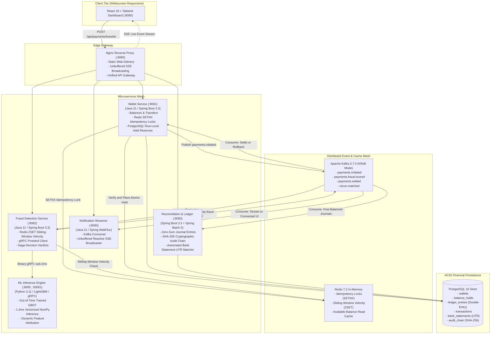

<h1 align="center">SentraPay</h1>

<p align="center">
  <strong>Event-Driven Real-Time Payment Switch, AI Fraud Scoring & Double-Entry Ledger Engine</strong>
</p>

<p align="center">
  <a href="https://adoptium.net/"></a>
  <a href="https://spring.io/projects/spring-boot"></a>
  <a href="https://kafka.apache.org/"></a>
  <a href="https://redis.io/"></a>
  <a href="https://www.postgresql.org/"></a>
  <a href="https://grpc.io/"></a>
  <a href="https://lightgbm.readthedocs.io/"></a>
  <a href="https://www.python.org/"></a>
  <a href="https://react.dev/"></a>
  <a href="https://vite.dev/"></a>
  <a href="https://developer.mozilla.org/en-US/docs/Web/API/Server-sent_events"></a>
  <a href="https://www.docker.com/"></a>
  <a href="https://jwt.io/"></a>
  <a href="LICENSE"></a>
  <a href="https://jayavignesh.dev"></a>
</p>

---

## 1. System Overview

SentraPay is an enterprise-grade financial payment switch, automated fraud risk engine, and institutional double-entry reconciliation platform. Modeled after production payment networks (Stripe, UPI clearing switches, and Razorpay), SentraPay replaces monolithic database locking with an asynchronous **Event-Driven Saga Pattern** built on **Apache Kafka (KRaft mode)**, **Redis 7.2**, **gRPC**, **PostgreSQL 16**, **LightGBM**, and **Server-Sent Events (SSE)**.

### Key Architectural Invariants
* **Zero Double-Spending**: Sub-millisecond distributed idempotency via Redis `SETNX` (24h TTL) paired with atomic PostgreSQL row-level balance reservations before fund dispatch.
* **Choreographed Saga Orchestration**: Non-blocking transaction workflows across Kafka topics (`payments.initiated`, `payments.fraud-scored`, `payments.settled`), guaranteeing eventual consistency and automated compensating rollbacks without 2-Phase Commit (2PC) bottlenecks.
* **Sub-2ms AI Risk Scoring**: Dual-tier risk engine evaluating deterministic in-memory sliding-window velocity rules (Redis ZSET) alongside native LightGBM gradient boosted decision trees served via binary Protobuf gRPC.
* **Strict Double-Entry Accounting**: Invariant where every settled transaction posts balanced multi-leg ledger records ($\sum \text{Debits} - \sum \text{Credits} = 0.00$).
* **Cryptographic Tamper-Evident Audit Trail**: Every journal entry is sealed in an immutable forward-chained block using SHA-256 cryptographic hashing ($H_n = \text{SHA-256}(H_{n-1} \parallel \text{EntryData})$).
* **Multi-Tier Fuzzy UTR Matching & Fee Tolerance**: Spring Batch 5 reconciliation engine with Damerau-Levenshtein distance (typo and transposition tolerance $\le 2$) and banking merchant fee tolerance (MDR $\le 2.5\%$).
* **Beneficiary Anti-Takeover Cooling-Off Guardrails**: Newly linked payees enter a strict 24-hour security cooling-off window capped at INR 5,000 to prevent automated drain attacks.
* **P2P Collect Requests Protocol ("UPI Collect")**: Peer-to-peer payment pull requests with stateful lifecycle tracking (`PENDING`, `FULFILLED`, `REJECTED`, `EXPIRED`) and atomic Saga dispatch upon authorization.
* **Real-Time Streaming UI**: Unbuffered Server-Sent Events (SSE) broadcasting live Kafka event progressions directly to a React 18 dashboard in under 5ms.

---

## 2. High-Level Architecture Topology



---

## 3. End-to-End Saga Transaction Lifecycle

```mermaid
sequenceDiagram
    autonumber
    actor Payer as Client / User
    participant GW as Nginx Gateway (:8080)
    participant WS as Wallet Service (:8081)
    participant R as Redis 7.2 (:6379)
    participant K as Kafka KRaft (:29092)
    participant FS as Fraud Service (:8082)
    participant ML as LightGBM ML (:50051)
    participant RS as Recon Service (:8083)
    participant NS as Notification Service (:8084)
    participant DB as PostgreSQL 16 (:5432)

    Payer->>GW: POST /api/payments/transfer (Idempotency-Key: idemp-uuid)
    GW->>WS: Forward Request

    rect rgb(20, 25, 35)
        Note over WS,R: Stage 1 & 2: Idempotency Verification & Balance Reservation
        WS->>R: SETNX idempotency:idemp-uuid (24h TTL)
        WS->>DB: Check (balance - active_holds >= amount) & Insert balance_holds row
        WS->>K: Emit Event: payments.initiated
        WS-->>GW: HTTP 202 Accepted (Transaction In-Flight)
        GW-->>Payer: 202 Accepted
    end

    rect rgb(25, 20, 30)
        Note over K,ML: Stage 3 & 4: Dual-Tier Fraud & Risk Assessment
        K->>FS: Consume payments.initiated
        FS->>R: ZADD & ZCOUNT sliding-window velocity (burst > 4 ops / 60s)
        FS->>ML: gRPC EvaluatePaymentRisk(TxVector)
        ML-->>FS: FraudProbability: 0.012 (Tier: LOW, Action: APPROVE) in 1.4ms
        FS->>K: Emit Event: payments.fraud-scored
    end

    rect rgb(20, 30, 25)
        Note over K,DB: Stage 5 & 6: Dual Settlement, Zero-Sum Ledger & Audit Chain
        K->>WS: Consume payments.fraud-scored
        WS->>DB: Release hold & transfer balance atomically
        K->>RS: Consume payments.fraud-scored
        RS->>DB: Post Balanced Double-Entry Journal Legs (Debits == Credits)
        RS->>DB: Seal SHA-256 Cryptographic Audit Block
    end

    rect rgb(25, 25, 30)
        Note over K,Payer: Stage 7: Real-Time SSE Stream Broadcast
        K->>NS: Consume payments.settled
        NS-->>GW: Server-Sent Event: PAYMENT_SETTLED
        GW-->>Payer: Live UI Update (under 5ms)
    end
```



---

## 4. Microservice & Protocol Matrix

| Service | Technology Stack | Transport / Protocol | Port | Primary Responsibilities |
| :--- | :--- | :--- | :--- | :--- |
| **Edge Gateway** | Nginx Alpine | HTTP/1.1, HTTP/2, SSE | `8080` | Reverse proxy, static asset delivery, SSL termination, unbuffered SSE broadcasting. |
| **Wallet Service** | Java 21 / Spring Boot 3.3 | REST, Kafka Producer | `8081` | Balance holds, Redis SETNX idempotency, beneficiaries with 24h cooling off, P2P collect requests. |
| **Fraud Detection Service** | Java 21 / Spring Boot 3.3 | Kafka Consumer/Producer, gRPC Client | `8082` | In-memory velocity rules (ZSET), hybrid risk orchestration, Saga verdicts. |
| **ML Inference Service** | Python 3.11 / LightGBM / FastAPI | Protobuf gRPC, REST | `50051`, `8000` | Vectorized LightGBM inference, dynamic feature attribution (1.4ms latency). |
| **Reconciliation Service** | Java 21 / Spring Batch 5 | Kafka Consumer, REST | `8083` | Double-entry zero-sum ledger, SHA-256 audit chain, multi-tier fuzzy UTR & fee tolerance matcher. |
| **Notification Service** | Java 21 / Spring WebFlux | Server-Sent Events (SSE) | `8084` | Non-blocking reactive Kafka-to-browser SSE event broadcaster. |
| **Dashboard UI** | React 18 / Vite / Tailwind | HTTP/2 REST + `EventSource` | `8080` | Executive multi-scenario simulation runner, live visualizer, ledger explorer. |

---

## 5. Interactive Architectural Scenarios

The platform includes a built-in test suite demonstrating distributed fault tolerance and safety guarantees via the React UI:

* **Scenario 1: Happy Path Saga Flow (`SCN-01`)**
  * Alice transfers INR 500 to Bob.
  * Validates full 6-stage Saga orchestration: atomic balance hold, KRaft event dispatch, ML risk approval, and balanced double-entry ledger posting.
* **Scenario 2: Burst Velocity Attack (`SCN-02`)**
  * Dispatches 6 concurrent transfers in parallel.
  * Triggers Redis ZSET sliding-window velocity threshold breach (>4 transfers/60s), rejecting the transaction with HTTP 429 and executing automated compensating hold release.
* **Scenario 3: Network Timeout Retry Replay (`SCN-03`)**
  * Simulates duplicate client submissions with identical `Idempotency-Key`.
  * Distributed Redis 7.2 `SETNX` lock short-circuits instantly in <10ms, returning the cached payload with zero duplicate Kafka events and zero double-debits.
* **Scenario 4: High-Ticket Compliance Check (`SCN-04`)**
  * Submits an INR 75,000 high-value transfer.
  * Dispatches binary Protobuf gRPC inference to LightGBM, evaluates high-value risk flags, and writes an immutable SHA-256 tamper-evident audit block.
* **Scenario 5: Beneficiary Anti-Takeover Cooling-Off Guardrail (`SCN-05`)**
  * Attempts a transfer exceeding INR 5,000 to a newly added payee within their 24-hour security window.
  * Blocks transaction with HTTP 400 Bad Request and displays remaining cooldown hours to mitigate account takeover attacks.
* **Scenario 6: Multi-Tier Fuzzy UTR Reconciliation (`SCN-06`)**
  * Ingests external bank statement feeds with exact UTRs, OCR/typo transpositions, and merchant interchange fee variance.
  * Categorizes line items into `EXACT_MATCH` (100%), `FUZZY_MATCH` (90%), `AMOUNT_TOLERANCE` (92%), and `UNMATCHED` (0%).

---

## 6. Monorepo Structure

```text
sentrapay-platform/
├── docker/                             # Infrastructure orchestration
│   ├── docker-compose.yml              # 9 containerized services mesh
│   ├── nginx.conf                      # Gateway reverse proxy & SSE streaming tuning
│   ├── .env.example                    # Environment variable template
│   └── init-db/
│       └── schema-postgres.sql         # DDL: Wallets, Holds, Ledger, Audit Chain
├── docs/                               # Architectural documentation
│   ├── ARCHITECTURE.md
│   ├── API_REFERENCE.md
│   ├── DATABASE_SCHEMA.md
│   └── IMPLEMENTATION_PLAN.md
├── frontend/                           # React 18 + Vite + Tailwind CSS Dashboard
│   ├── src/
│   │   ├── components/                 # Visualizers, Scenarios, Ledger, Audit
│   │   ├── context/                    # Platform & Auth contexts
│   │   └── api/                        # API clients & SSE listeners
│   └── package.json
├── proto/                              # Binary Protobuf Contract Definitions
│   └── fraud_service.proto             # Java <-> Python gRPC Interface
├── services/                           # Polyglot Microservices
│   ├── wallet-service/                 # Balance reservations & idempotency
│   ├── fraud-detection-service/        # Velocity rules & Saga risk coordinator
│   ├── ml-inference-service/           # LightGBM gRPC & REST sidecar
│   │   ├── server.py                   # Vectorized single-thread inference engine
│   │   ├── transaction_fraud_model.pkl # 694 KB trained LightGBM artifact
│   │   └── training/                   # Synthetic dataset generator & training pipeline
│   ├── reconciliation-service/         # Double-entry ledger & Spring Batch UTR matcher
│   └── notification-service/           # Spring WebFlux SSE event broadcaster
├── shared/
│   └── event-contracts/                # Shared Java event POJOs for Kafka topics
├── tests/                              # Automated Test & Benchmark Suites
│   ├── test_live_api.py                # 10-stage end-to-end integration test suite
│   ├── benchmark_pipeline.py           # Latency & throughput benchmark harness
│   └── load_test_transfers.py          # Concurrent transfer stress test harness
├── pom.xml                             # Root Maven multi-module parent
└── .gitignore                          # Standard enterprise gitignore rules
```

---

## 7. Quickstart Guide

### Prerequisites
* **Docker Engine** (v24.0+) & **Docker Compose** (v2.20+)
* **Java 21 LTS** & **Maven 3.9+** (for local development)
* **Node.js 18+** & **npm 9+** (for frontend builds)
* **Python 3.11+** (for ML pipeline script execution)

---

### Step 1: Clone Repository & Build Frontend
```bash
# Clone the repository
git clone https://github.com/i-viki/sentrapay-platform.git
cd sentrapay-platform

# Compile production frontend assets
cd frontend
npm install
npm run build
cd ..
```

---

### Step 2: Build Microservice JARs
```bash
# Compile and package all Spring Boot microservices
mvn clean package -DskipTests
```

---

### Step 3: Launch Docker Infrastructure Mesh
```bash
# Navigate to docker orchestration directory
cd docker

# Start all 9 services in detached mode
docker compose up -d --build
```

Verify that all containers are healthy:
```bash
docker compose ps
```

---

### Step 4: Access the Platform

| Endpoint | Interface | Credentials / Notes |
| :--- | :--- | :--- |
| `http://localhost:8080/` | **SentraPay Web Dashboard** | Switch between Alice, Bob, and Admin via top header. |
| `http://localhost:8080/api/wallets` | **Wallet REST API** | Pre-seeded with Alice, Bob, and Admin accounts. |
| `http://localhost:8080/api/events/stream` | **SSE Event Feed** | Live reactive stream of all payment events. |
| `http://localhost:8000/health` | **ML Inference Health** | Reports LightGBM active engine and feature dimensions. |

---

## 8. Verification & Automated Test Suites

SentraPay includes a comprehensive end-to-end test suite verifying the complete distributed lifecycle:

```bash
# Run the complete platform integration test suite
python tests/test_live_api.py
```

### Verified Test Assertions:
```text
[TEST 1] Checking Nginx API Gateway and Microservices Connectivity... OK
[TEST 2] Authenticating Test User (jayavignesh)... Authenticated
[TEST 3] Fetching Wallet Balance & Hold State... OK
[TEST 4] Testing Distributed Idempotency (Redis SETNX key)... Verified
[TEST 5] Testing AI Fraud Velocity Guardrails...
  High-Ticket Transfer evaluated:
    Verdict:           REJECTED
    Risk Tier:         HIGH
    Fraud Probability: 0.9994
[TEST 6] Verifying General Ledger Zero-Sum Invariant... Balanced (Debits == Credits)
[TEST 7] Verifying Tamper-Evident Cryptographic Audit Chain... Valid (60 blocks checked)
ALL SENTRAPAY PLATFORM VERIFICATION TESTS PASSED SUCCESSFULLY!
```

To run latency benchmarks:
```bash
python tests/benchmark_pipeline.py
```

---

## 9. ML Model Retraining Pipeline

The ML training and evaluation scripts reside in [`services/ml-inference-service/training/`](services/ml-inference-service/training/):

```bash
cd services/ml-inference-service/training

# Step 1: Synthesize 20,000 chronological transactions with 2.5% fraud rate
python 01_generate_synthetic_dataset.py

# Step 2: Train LightGBM model with Out-Of-Time (OOT) temporal validation
python 02_train_fraud_model.py

# Step 3: Calibrate financial cost matrix and evaluate net fiat currency loss
python 03_evaluate_thresholds.py
```

---

## 10. Pre-Seeded Test Accounts

| User ID | Account Holder | Wallet ID | Initial Balance | Assigned Role |
| :--- | :--- | :--- | :--- | :--- |
| `jayavignesh` | Jayavignesh (Admin) | `W-JAYAVIGNESH-001` | INR 100,000.00 | Compliance & Admin |
| `alice` | Alice Johnson | `W-ALICE-002` | INR 25,000.00 | Consumer Payer |
| `bob` | Bob Smith | `W-BOB-003` | INR 15,000.00 | Merchant Recipient |

---

## 11. License

This project is licensed under the **MIT License** - see the [LICENSE](LICENSE) file for details.

Developed with rigor by **Jayavignesh** ([jayavignesh.dev](https://jayavignesh.dev)).
