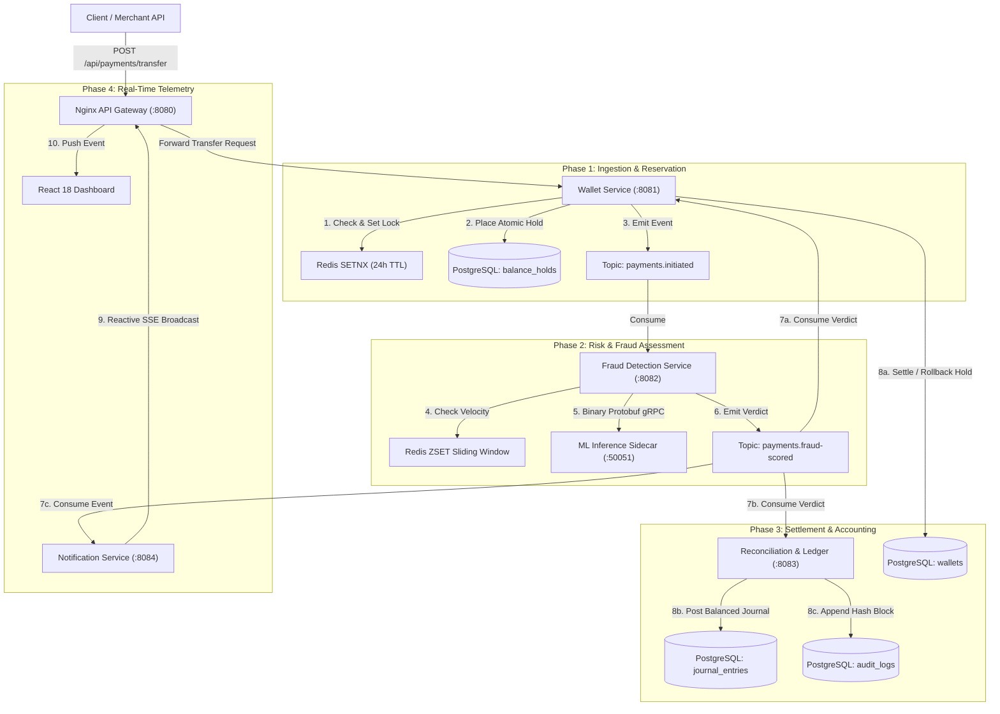
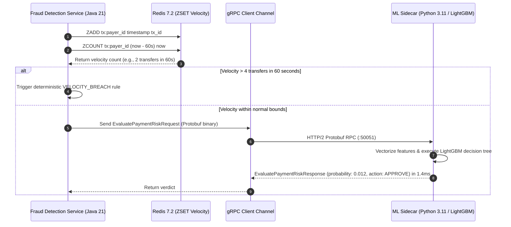
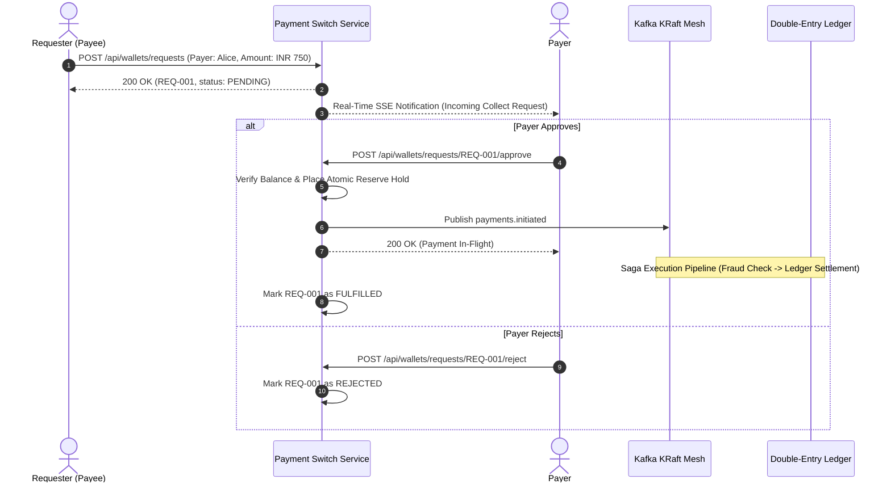
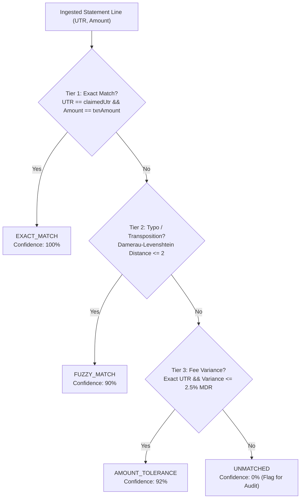

# SentraPay System Architecture

This document provides an in-depth architectural breakdown of the SentraPay high-throughput core payment switch, AI fraud scoring engine, and institutional double-entry ledger platform.

---

## 1. Architectural Philosophy

Traditional payment architectures often suffer from:
1. **Monolithic 2-Phase Commit (2PC) bottlenecks**: Holding distributed database locks across services severely degrades throughput and creates catastrophic cascading failures under high concurrency.
2. **Race conditions and double-spending**: Concurrent transfer requests from the same account can overdraw funds if balance validation and balance deduction are not atomic.
3. **Black-box, high-latency fraud detection**: Synchronous REST calls to external ML services introducing 100ms+ tail latencies.
4. **Single-entry balance tracking**: Modifying a single mutable balance field without balanced ledger journals makes auditing, forensic reconciliation, and regulatory compliance impossible.

SentraPay addresses these fundamental challenges through:
- **Asynchronous Choreographed Saga Pattern**: Decoupled, non-blocking state progression coordinated via Apache Kafka 3.7.0 (KRaft mode).
- **Two-Phase Balance Reservation Pattern**: Immediate atomic balance holds via PostgreSQL row-level locks and Redis `SETNX` idempotency, preventing double-spending while awaiting asynchronous Saga verdicts.
- **Ultra-Low Latency gRPC ML Sidecar**: Vectorized LightGBM GBDT running in a Python 3.11 sidecar communicating over binary HTTP/2 Protobuf protocol with sub-2ms P99 inference latency.
- **Strict Double-Entry General Ledger**: Every settled transaction generates immutable multi-leg journal entries that mathematically enforce $\sum \text{Debits} = \sum \text{Credits}$.
- **Cryptographic Forward-Chained Audit Trail**: SHA-256 hash chains guaranteeing tamper-evident immutability.
- **Reactive Streaming UI**: Spring WebFlux Server-Sent Events (SSE) delivering sub-5ms event telemetry directly to the frontend operator console.

---

## 2. Distributed Saga Orchestration

SentraPay implements a choreographed Saga pattern where microservices communicate via discrete, append-only Kafka topics.

### Saga State Transitions

| State | Responsible Service | Trigger | Description |
| :--- | :--- | :--- | :--- |
| `INITIATED` | `wallet-service` | API Request | Validates idempotency, creates transaction record, and reserves funds via a balance hold. |
| `FRAUD_EVALUATED` | `fraud-detection-service` | `payments.initiated` | Assesses velocity and ML fraud probability, outputting `APPROVE`, `REVIEW`, or `REJECT`. |
| `SETTLED` | `wallet-service` / `recon-service` | `payments.fraud-scored` (APPROVE) | Debits sender, credits recipient, releases balance hold, and writes double-entry ledger legs. |
| `REJECTED` | `wallet-service` | `payments.fraud-scored` (REJECT) | Releases the balance hold without deducting funds, marking transaction `REJECTED`. |

---

## 3. Distributed Idempotency Engine

To prevent duplicate payment charges resulting from network timeouts or aggressive client retries, SentraPay implements an atomic two-stage deduplication mechanism:

1. **Redis Atomic Distributed Lock**:
   - Every transfer requires an `X-Idempotency-Key` HTTP header.
   - The service attempts an atomic `SET key val NX EX 86400` in Redis.
   - If the key already exists and has an associated cached response, the existing payment response is returned immediately with HTTP 200, bypassing the Kafka event bus entirely.
   - If the key exists with `IN_PROGRESS`, concurrent duplicate requests receive HTTP 409 Conflict.

2. **Database Unique Constraints**:
   - The `transactions` table enforces a `UNIQUE` constraint on `idempotency_key`.
   - Even in the event of a cache eviction or Redis cold restart, the database rejects duplicates at the storage layer.

---

## 4. Ultra-Low Latency ML Inference Pipeline

### Cost-Sensitive Decision Calibration

The inference engine evaluates transaction vectors against a calibrated financial loss matrix:
- **Low Risk ($\text{Score} < 0.35$)**: Automated instant approval. Funds dispatched immediately.
- **Medium Risk ($0.35 \le \text{Score} \le 0.70$)**: Flagged for compliance review.
- **High Risk ($\text{Score} > 0.70$)**: Instant automated rejection. Balance hold released immediately.

---

## 5. Double-Entry General Ledger

SentraPay adheres to standard institutional accounting standards:
- Every transaction creates a `journal_entry` containing at least two balanced `journal_lines`.
- The database enforces `chk_balanced_entry CHECK (total_debit = total_credit)`.
- Available chart of accounts:
  - `1010`: Central Escrow Cash Account (Asset)
  - `1020`: Bank Settlement Inward Clearing (Asset)
  - `2010`: User Wallet Balances (Liability)
  - `2020`: Active Balance Holds (Liability)
  - `3010`: Operational Reserves (Equity)
  - `4010`: Payment Processing Fee Revenue (Revenue)
  - `5010`: Network & Gateway Clearing Expenses (Expense)

---

## 6. Tamper-Evident SHA-256 Audit Trail

All critical balance holds, transfer settlements, and ledger entries append an immutable audit record to `audit_logs`:
$$H_n = \text{SHA-256}(H_{n-1} \parallel \text{action\_type} \parallel \text{entity\_id} \parallel \text{payload} \parallel \text{timestamp})$$

Any modification of past records invalidates all subsequent hash pointers in the chain, enabling immediate forensic tamper detection via `/api/recon/audit/verify`.

---

## 7. Beneficiary Management & Anti-Takeover Cooling-Off Guardrails

Account takeover (ATO) attacks often follow a distinct pattern: compromised credentials are used to swiftly bind a new external destination account or wallet, followed immediately by high-value drainage transfers.

To neutralize this attack vector:
1. **Mandatory 24-Hour Cooling-Off Window**:
   - Every newly registered beneficiary automatically receives a `cooling_off_until` timestamp set to `now() + 24 hours`.
   - The user interface surfaces an active countdown badge indicating the remaining cooling-off duration.
2. **Transfer Ceiling Enforcement**:
   - During the active cooling-off period, transfers directed to the payee are strictly capped at INR 5,000.00.
   - Any transfer attempt exceeding this ceiling is short-circuited at the payment switch before balance reservation, returning HTTP 400 Bad Request with an audit log entry.
3. **Automated Window Expiration**:
   - Once the 24-hour security window elapses, the beneficiary transitions automatically to the standard daily limit (default INR 50,000.00) without requiring manual administrative intervention.

---

## 8. Peer-to-Peer Payment Requests Protocol ("UPI Collect")

SentraPay implements a stateful peer-to-peer payment pull protocol modeled after UPI Collect mandates:

### Request Lifecycle States:
- `PENDING`: Collect request generated, awaiting payer review.
- `FULFILLED`: Payer confirmed, funds reserved, and transaction dispatched to the Saga switch.
- `REJECTED`: Explicitly dismissed by the target payer.
- `EXPIRED`: Request reached expiry deadline (default 24h) without action.

---

## 9. Multi-Tier Fuzzy UTR Matching & Fee Tolerance Reconciliation

External bank statement reconciliation often encounters two critical real-world discrepancies:
1. **Typographical & Transposition Errors**: OCR scanning artifacts or manual keyboard errors in bank Unique Transaction Reference (UTR) strings (e.g., swapping `HDFC...9901` to `HDFC...9910`).
2. **Merchant Discount Rate (MDR) Variance**: Payment aggregators and intermediary clearinghouses deducting 1.0% to 2.5% interchange fees prior to gross settlement.

SentraPay implements a 4-tier heuristic matching engine in Spring Batch 5:

### Heuristic Mathematical Criteria:
- **Damerau-Levenshtein Distance**: Evaluates insertions, deletions, substitutions, and adjacent transpositions:
  $$d(s_1, s_2) \le 2 \implies \text{Match with 90\% Confidence}$$
- **MDR Fee Tolerance Formula**:
  $$\frac{|\text{Statement Amount} - \text{Ledger Amount}|}{\text{Ledger Amount}} \le 0.025 \implies \text{Match with 92\% Confidence}$$
- **Cryptographic File Deduplication**: Statement files are hashed via SHA-256 upon upload; identical checksums are rejected to prevent duplicate settlement.

