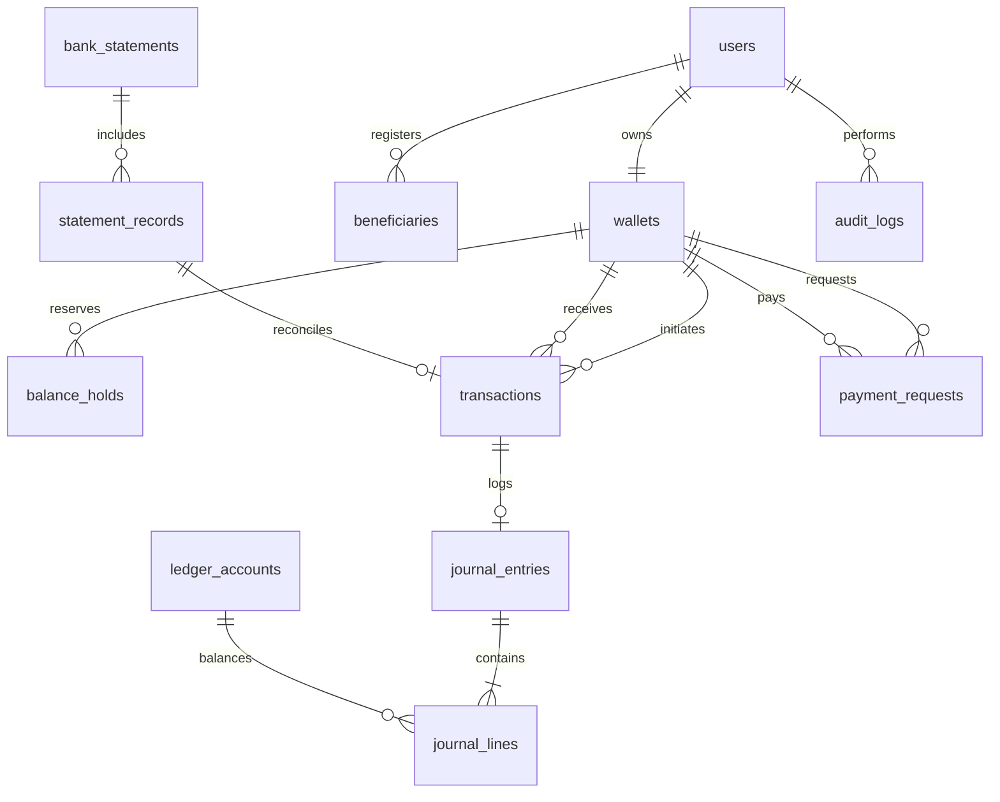

# SentraPay Database Schema Documentation

SentraPay uses PostgreSQL 16 as its relational persistence store with strict ACID compliance, foreign key integrity, check constraints, and B-tree indexing.

---

## 1. Entity-Relationship Overview



---

## 2. Table Specifications

### 2.1 `users`
Stores user identities, credentials, and role-based permissions.

| Column | Type | Constraints | Description |
| :--- | :--- | :--- | :--- |
| `id` | `BIGSERIAL` | PRIMARY KEY | Unique user surrogate ID |
| `username` | `VARCHAR(50)` | NOT NULL, UNIQUE | Username for authentication |
| `email` | `VARCHAR(100)` | NOT NULL, UNIQUE | Account contact email |
| `password_hash`| `VARCHAR(255)` | NOT NULL | BCrypt password hash |
| `full_name` | `VARCHAR(100)` | NOT NULL | User's full legal name |
| `phone_number` | `VARCHAR(20)` | NULL | Associated mobile number |
| `role` | `VARCHAR(20)` | NOT NULL, DEFAULT 'USER' | Role (`ADMIN`, `USER`, `AUDITOR`) |
| `created_at` | `TIMESTAMPTZ` | DEFAULT CURRENT_TIMESTAMP | Account creation timestamp |

### 2.2 `wallets`
Stores current currency balances and account status.

| Column | Type | Constraints | Description |
| :--- | :--- | :--- | :--- |
| `id` | `BIGSERIAL` | PRIMARY KEY | Unique wallet ID |
| `user_id` | `BIGINT` | NOT NULL, UNIQUE, FK -> `users(id)` | Owning user account |
| `wallet_number`| `VARCHAR(64)` | NOT NULL, UNIQUE | Formatted identifier (e.g., `W-ALICE-002`) |
| `currency` | `VARCHAR(3)` | NOT NULL, DEFAULT 'INR' | ISO-4217 currency code |
| `initial_balance`| `NUMERIC(15,2)`| NOT NULL, DEFAULT 0.00 | Account starting balance |
| `status` | `VARCHAR(20)` | NOT NULL, DEFAULT 'ACTIVE' | Status (`ACTIVE`, `FROZEN`, `CLOSED`) |
| `created_at` | `TIMESTAMPTZ` | DEFAULT CURRENT_TIMESTAMP | Wallet creation timestamp |

### 2.3 `balance_holds`
Implements the two-phase balance reservation pattern to eliminate double-spending.

| Column | Type | Constraints | Description |
| :--- | :--- | :--- | :--- |
| `id` | `BIGSERIAL` | PRIMARY KEY | Unique hold ID |
| `wallet_id` | `BIGINT` | NOT NULL, FK -> `wallets(id)` | Reserved wallet account |
| `transaction_id`| `BIGINT` | NOT NULL | Associated transaction identifier |
| `amount` | `NUMERIC(15,2)`| NOT NULL, CHECK (amount > 0) | Held monetary amount |
| `status` | `VARCHAR(20)` | NOT NULL, DEFAULT 'ACTIVE' | Hold status (`ACTIVE`, `RELEASED`, `SETTLED`) |
| `expires_at` | `TIMESTAMPTZ` | NOT NULL | Auto-expiry deadline for stuck sagas |
| `created_at` | `TIMESTAMPTZ` | DEFAULT CURRENT_TIMESTAMP | Hold placement timestamp |

### 2.4 `transactions`
Lifecycle ledger of all payment attempts and settled transfers.

| Column | Type | Constraints | Description |
| :--- | :--- | :--- | :--- |
| `id` | `BIGSERIAL` | PRIMARY KEY | Internal surrogate transaction ID |
| `payment_reference`| `VARCHAR(64)` | NOT NULL, UNIQUE | Public reference (`TXN-...`) |
| `idempotency_key`| `VARCHAR(128)`| NOT NULL, UNIQUE | Distributed deduplication key |
| `sender_wallet_id`| `BIGINT` | NOT NULL, FK -> `wallets(id)` | Source wallet |
| `recipient_wallet_id`| `BIGINT`| NOT NULL, FK -> `wallets(id)` | Destination wallet |
| `amount` | `NUMERIC(15,2)`| NOT NULL, CHECK (amount > 0) | Transfer amount |
| `currency` | `VARCHAR(3)` | NOT NULL, DEFAULT 'INR' | Currency code |
| `payment_method`| `VARCHAR(50)` | NOT NULL | Channel (`UPI`, `IMPS`, `NEFT`, `CARD`) |
| `claimed_utr` | `VARCHAR(100)` | NULL | Provided bank UTR reference |
| `status` | `VARCHAR(50)` | NOT NULL, DEFAULT 'INITIATED'| Saga state (`INITIATED`, `FRAUD_EVALUATED`, `SETTLED`, `REJECTED`) |
| `created_at` | `TIMESTAMPTZ` | DEFAULT CURRENT_TIMESTAMP | Transaction timestamp |

### 2.5 `beneficiaries`
Enforces payee security guardrails and anti-takeover cooling-off ceilings.

| Column | Type | Constraints | Description |
| :--- | :--- | :--- | :--- |
| `id` | `BIGSERIAL` | PRIMARY KEY | Surrogate beneficiary ID |
| `user_id` | `BIGINT` | NOT NULL, FK -> `users(id)` | User who registered the payee |
| `beneficiary_name`| `VARCHAR(100)` | NOT NULL | Friendly display nickname |
| `recipient_wallet_number`| `VARCHAR(64)`| NOT NULL | Target wallet identifier |
| `cooling_off_until`| `TIMESTAMPTZ`| NOT NULL | Timestamp when 24h cooling off concludes |
| `daily_limit` | `NUMERIC(15,2)`| NOT NULL, DEFAULT 50000.00 | Maximum daily transfer allowance |
| `created_at` | `TIMESTAMPTZ` | DEFAULT CURRENT_TIMESTAMP | Payee registration timestamp |

### 2.6 `payment_requests`
Maintains peer-to-peer payment pull request ("UPI Collect") lifecycles.

| Column | Type | Constraints | Description |
| :--- | :--- | :--- | :--- |
| `id` | `BIGSERIAL` | PRIMARY KEY | Surrogate collect request ID |
| `request_reference`| `VARCHAR(64)`| NOT NULL, UNIQUE | Public request identifier (`REQ-...`) |
| `requester_wallet_id`| `BIGINT` | NOT NULL, FK -> `wallets(id)` | Wallet requesting funds |
| `payer_wallet_id`| `BIGINT` | NOT NULL, FK -> `wallets(id)` | Target wallet responsible for payment |
| `amount` | `NUMERIC(15,2)`| NOT NULL, CHECK (amount > 0) | Requested monetary sum |
| `currency` | `VARCHAR(3)` | NOT NULL, DEFAULT 'INR' | Currency code |
| `description` | `VARCHAR(255)` | NULL | Narration / purpose of request |
| `status` | `VARCHAR(50)` | NOT NULL, DEFAULT 'PENDING'| State (`PENDING`, `FULFILLED`, `REJECTED`, `EXPIRED`) |
| `expires_at` | `TIMESTAMPTZ` | NOT NULL | Expiry deadline |
| `fulfilled_payment_reference`| `VARCHAR(64)`| NULL | Settled switch transaction reference |
| `created_at` | `TIMESTAMPTZ` | DEFAULT CURRENT_TIMESTAMP | Creation timestamp |
| `updated_at` | `TIMESTAMPTZ` | DEFAULT CURRENT_TIMESTAMP | Last state modification timestamp |

### 2.7 Bank Statement & Reconciliation Tables

#### `bank_statements`
Ingested banking clearinghouse feeds.
- `filename`: External statement file name.
- `file_hash_sha256`: Unique SHA-256 checksum enforcing deduplication.
- `source_channel`: Origin clearinghouse (e.g., `HDFC_BANK`, `RAZORPAY`).
- `status`: Processing status (`PROCESSING`, `COMPLETED`, `FAILED`).

#### `statement_records`
Individual transaction lines extracted from clearing statements with multi-tier fuzzy matching classification:

| Column | Type | Constraints | Description |
| :--- | :--- | :--- | :--- |
| `id` | `BIGSERIAL` | PRIMARY KEY | Surrogate line item ID |
| `statement_id` | `BIGINT` | NOT NULL, FK -> `bank_statements(id)` | Parent statement feed |
| `utr_number` | `VARCHAR(100)` | NOT NULL | Bank Unique Transaction Reference |
| `transaction_date`| `TIMESTAMPTZ`| NOT NULL | Clearing timestamp |
| `amount` | `NUMERIC(15,2)`| NOT NULL | Cleared transaction amount |
| `payer_vpa` | `VARCHAR(100)` | NULL | External Virtual Payment Address |
| `is_reconciled` | `BOOLEAN` | NOT NULL, DEFAULT FALSE | Matching resolution flag |
| `match_type` | `VARCHAR(50)` | DEFAULT 'UNMATCHED' | Classification (`EXACT_MATCH`, `FUZZY_MATCH`, `AMOUNT_TOLERANCE`, `UNMATCHED`) |
| `confidence_score`| `NUMERIC(5,2)`| DEFAULT 0.00 | Matching engine confidence percentage (0.00% - 100.00%) |
| `discrepancy_reason`| `VARCHAR(255)`| NULL | Explanation of fee variance or Damerau-Levenshtein distance |
| `reconciled_transaction_id`| `BIGINT`| NULL, FK -> `transactions(id)` | Correlated internal transaction |

### 2.8 Double-Entry Accounting Tables

#### `ledger_accounts`
Chart of institutional accounts:
- `1010`: Central Escrow Cash Account (`ASSET`)
- `1020`: Bank Settlement Inward Clearing (`ASSET`)
- `2010`: User Wallet Balances (`LIABILITY`)
- `2020`: Active Balance Holds (`LIABILITY`)
- `3010`: Operational Reserves (`EQUITY`)
- `4010`: Payment Processing Fee Revenue (`REVENUE`)
- `5010`: Network & Gateway Clearing Expenses (`EXPENSE`)

#### `journal_entries`
Records multi-leg journal headers with balance check invariant:
```sql
CONSTRAINT chk_balanced_entry CHECK (total_debit = total_credit)
```

#### `journal_lines`
Individual debit/credit legs associated with each journal entry:
- `entry_type`: `'DEBIT'` or `'CREDIT'`
- `amount`: `NUMERIC(15, 2) CHECK (amount > 0)`

### 2.9 `audit_logs`
Tamper-evident SHA-256 hash-chained block records:
- `previous_hash`: SHA-256 digest of preceding audit block.
- `record_hash`: SHA-256 digest of current payload combined with previous hash ($H_n = \text{SHA-256}(H_{n-1} \parallel \text{EntryData})$).
