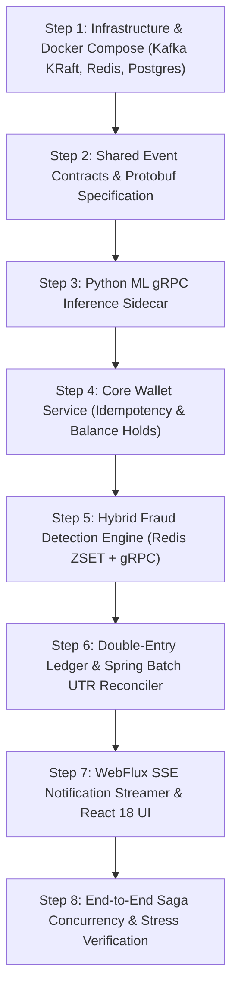

# SentraPay: Enterprise Architecture Specification & Master Implementation Plan

**Author:** Jayavignesh ([jayavignesh.dev](https://jayavignesh.dev))  
**Platform:** SentraPay Event-Driven Real-Time Payment Switch, AI Fraud Scoring & Double-Entry Reconciliation Engine  
**Standard:** Tier-1 FinTech Production Engineering (Stripe / PayPal / UPI Architecture)  
**Version:** 1.0.0 Production  

---

## 1. Architectural Invariants & Enterprise Design Standards

To ensure SentraPay operates with the reliability of a Tier-1 product company, the architecture enforces seven non-negotiable engineering invariants:

1. **Distributed Idempotency (Strict Once-and-Only-Once Processing):**
   * Every state-mutating HTTP request (`POST /api/payments/transfer`, `POST /api/wallets/deposit`) requires an `Idempotency-Key` UUID header.
   * Redis evaluates and acquires keys atomically via `SET idempotency:<key> <in_progress_marker> NX EX 86400` (24-hour TTL).
   * Concurrent duplicate requests return `409 Conflict` or poll until the original response is cached. Subsequent retries return the exact cached payload without re-executing business logic.

2. **Distributed Saga Choreography (No Two-Phase Commit):**
   * Traditional 2PC locks databases across microservices, creating single-point-of-failure deadlocks.
   * SentraPay uses asynchronous event choreography over Apache Kafka. When a payment initiates, funds are placed on `HOLD` (not debited).
   * If the fraud service approves, the hold commits to final settlement. If rejected, compensating logic releases the hold immediately.

3. **Double-Entry Balance Conservation Invariant:**
   * Money cannot be created, updated, or destroyed through arbitrary `UPDATE accounts SET balance = balance - X` queries.
   * Every transaction is recorded as balanced pairs in `ledger_entries`:
     $$\sum \text{Debits} - \sum \text{Credits} = 0$$
   * User available balance is an ACID aggregate view:
     $$\text{Available Balance} = \text{Initial Balance} + \sum \text{Credits} - \sum \text{Debits} - \sum \text{Active Holds}$$

4. **Sub-3ms High-Speed Binary Model Inference:**
   * Inter-service HTTP/1.1 JSON parsing adds 20–40ms of latency, unacceptable in real-time payment switches.
   * The Java `fraud-detection-service` communicates with the Python `ml-inference-service` via **gRPC over HTTP/2 using binary Protocol Buffers (Protobuf)**, achieving $< 3\text{ms}$ scoring.

5. **Strict Per-Account Partition Ordering:**
   * All payment events for a specific account are published to Kafka using the `sender_wallet_id` as the message key.
   * Guarantees that transactions for any single wallet are processed strictly in chronological sequence, preventing race conditions.

6. **Native Streaming over Server-Sent Events (SSE):**
   * Replaces legacy STOMP WebSockets with HTTP/2 Server-Sent Events (`EventSource`).
   * Eliminates WebSocket framing overhead, avoids proxy upgrade dropouts, and supports native browser auto-reconnects with exponential backoff.

7. **Tamper-Evident Hash-Chained Audit Trails:**
   * Every administrative, payment, and reconciliation action appends to an immutable audit ledger where:
     $$\text{Record Hash}_n = \text{SHA-256}(\text{ID}_n + \text{Payload}_n + \text{Timestamp}_n + \text{Record Hash}_{n-1})$$
   * Any manual database manipulation breaks the mathematical hash chain and is immediately flagged by integrity monitors.

---

## 2. Data & Message Contracts Specification

### 2.1 Apache Kafka Event Topics & Schemas

| Topic Name | Key | Producer Service | Consumer Services | Payload Schema / Purpose |
| :--- | :--- | :--- | :--- | :--- |
| `payments.initiated` | `sender_wallet_id` | `wallet-service` | `fraud-detection-service` | `PaymentInitiatedEvent` (TxID, Payer, Payee, Amount, Channel, DeviceIP, Timestamp) |
| `payments.fraud-scored` | `payment_id` | `fraud-detection-service` | `wallet-service`, `reconciliation-service`, `notification-service` | `FraudScoredEvent` (TxID, RiskScore, Verdict: `APPROVED` / `REVIEW` / `REJECTED`, RuleTriggers) |
| `payments.settled` | `payment_id` | `wallet-service` | `reconciliation-service`, `notification-service` | `PaymentSettledEvent` (TxID, SettledAmount, PayerWallet, PayeeWallet, SettledAt) |
| `reconciliation.events` | `utr_number` | `reconciliation-service` | `notification-service` | `ReconMatchedEvent` (UTR, InternalTxId, MatchType, DiscrepancyNotes) |

---

### 2.2 Binary gRPC Contract (`proto/fraud_service.proto`)

```protobuf
syntax = "proto3";

package dev.jayavignesh.sentrapay.fraud;

option java_multiple_files = true;
option java_package = "dev.jayavignesh.sentrapay.fraud.grpc";
option java_outer_classname = "FraudServiceProto";

service FraudInferenceService {
  rpc EvaluatePaymentRisk (PaymentRiskRequest) returns (PaymentRiskResponse);
  rpc HealthCheck (HealthRequest) returns (HealthResponse);
}

message PaymentRiskRequest {
  string transaction_id = 1;
  int64 sender_id = 2;
  int64 recipient_id = 3;
  double amount = 4;
  string payment_channel = 5;       // "UPI", "WALLET_TRANSFER", "NEFT"
  int32 velocity_last_1min = 6;      // Transaction count in last 60s
  int32 velocity_last_1hour = 7;     // Transaction count in last 60m
  double user_avg_amount_30d = 8;    // Historical 30-day baseline average
  int32 hour_of_day = 9;             // 0 - 23
  string device_ip = 10;
  bool is_new_recipient = 11;
}

message PaymentRiskResponse {
  string transaction_id = 1;
  double fraud_probability = 2;     // 0.000 to 1.000
  string risk_tier = 3;             // "LOW", "MEDIUM", "HIGH"
  string action = 4;                // "APPROVE", "MANUAL_REVIEW", "REJECT"
  int64 inference_time_nanos = 5;
  repeated string flagged_indicators = 6;
}

message HealthRequest {}
message HealthResponse {
  string status = 1; // "SERVING"
}
```

---

### 2.3 Redis Key Schema & TTL Policies

| Key Pattern | Data Structure | TTL | Purpose |
| :--- | :--- | :--- | :--- |
| `idemp:{idempotency_key}` | `STRING` (JSON payload) | 86400s (24h) | Atomic idempotency lock and cached response. |
| `velocity:acct:{wallet_id}` | `ZSET` (score = timestamp, member = tx_id) | 3600s (1h) | Sliding-window velocity tracking for fraud detection. |
| `velocity:ip:{ip_address}` | `ZSET` (score = timestamp, member = tx_id) | 3600s (1h) | IP-level burst rate monitoring (card-testing defense). |
| `hold:wallet:{wallet_id}` | `STRING` (numeric sum) | Transient | Real-time aggregate of active balance holds. |
| `rate:acct:{wallet_id}` | `STRING` (Token bucket counter) | 60s | Edge rate limiting (max 10 requests/min). |

---

### 2.4 Unified PostgreSQL 16 Relational Schema

```sql
-- Core Users & Wallets
CREATE TABLE IF NOT EXISTS users (
    id BIGSERIAL PRIMARY KEY,
    username VARCHAR(100) NOT NULL UNIQUE,
    email VARCHAR(150) NOT NULL UNIQUE,
    password_hash VARCHAR(255) NOT NULL,
    full_name VARCHAR(150) NOT NULL,
    phone_number VARCHAR(20) NULL,
    role VARCHAR(50) NOT NULL DEFAULT 'USER', -- 'USER', 'ADMIN', 'COMPLIANCE_OFFICER'
    is_active BOOLEAN NOT NULL DEFAULT TRUE,
    created_at TIMESTAMP WITH TIME ZONE DEFAULT CURRENT_TIMESTAMP
);

CREATE TABLE IF NOT EXISTS wallets (
    id BIGSERIAL PRIMARY KEY,
    user_id BIGINT NOT NULL UNIQUE REFERENCES users(id) ON DELETE CASCADE,
    wallet_number VARCHAR(64) NOT NULL UNIQUE,
    currency VARCHAR(3) NOT NULL DEFAULT 'INR',
    status VARCHAR(50) NOT NULL DEFAULT 'ACTIVE', -- 'ACTIVE', 'FROZEN', 'SUSPENDED'
    version BIGINT NOT NULL DEFAULT 0,            -- Optimistic locking counter
    created_at TIMESTAMP WITH TIME ZONE DEFAULT CURRENT_TIMESTAMP
);

-- Balance Holds (Saga In-Flight Reservations)
CREATE TABLE IF NOT EXISTS balance_holds (
    id BIGSERIAL PRIMARY KEY,
    wallet_id BIGINT NOT NULL REFERENCES wallets(id) ON DELETE CASCADE,
    payment_reference VARCHAR(64) NOT NULL UNIQUE,
    hold_amount NUMERIC(15, 2) NOT NULL CHECK (hold_amount > 0),
    status VARCHAR(50) NOT NULL DEFAULT 'ACTIVE', -- 'ACTIVE', 'COMMITTED', 'RELEASED'
    created_at TIMESTAMP WITH TIME ZONE DEFAULT CURRENT_TIMESTAMP,
    expires_at TIMESTAMP WITH TIME ZONE NOT NULL
);

-- Transaction Audit & State Tracking
CREATE TABLE IF NOT EXISTS transactions (
    id BIGSERIAL PRIMARY KEY,
    payment_reference VARCHAR(64) NOT NULL UNIQUE,
    idempotency_key VARCHAR(64) NOT NULL UNIQUE,
    sender_wallet_id BIGINT NOT NULL REFERENCES wallets(id),
    recipient_wallet_id BIGINT NOT NULL REFERENCES wallets(id),
    amount NUMERIC(15, 2) NOT NULL CHECK (amount > 0),
    currency VARCHAR(3) NOT NULL DEFAULT 'INR',
    payment_channel VARCHAR(50) NOT NULL DEFAULT 'WALLET_TRANSFER',
    status VARCHAR(50) NOT NULL DEFAULT 'INITIATED', -- 'INITIATED', 'HOLD_APPLIED', 'SETTLED', 'FAILED', 'MANUAL_REVIEW'
    risk_score NUMERIC(5, 4) NULL,
    risk_tier VARCHAR(20) NULL,
    claimed_utr VARCHAR(100) NULL,
    failure_reason VARCHAR(255) NULL,
    created_at TIMESTAMP WITH TIME ZONE DEFAULT CURRENT_TIMESTAMP,
    updated_at TIMESTAMP WITH TIME ZONE DEFAULT CURRENT_TIMESTAMP
);

-- Double-Entry Financial Ledger (ACID Source of Truth)
CREATE TABLE IF NOT EXISTS ledger_accounts (
    id BIGSERIAL PRIMARY KEY,
    code VARCHAR(50) NOT NULL UNIQUE, -- '1010-CASH', '2010-WALLET-LIABILITY', '4010-FEE-REVENUE'
    name VARCHAR(100) NOT NULL,
    type VARCHAR(50) NOT NULL,        -- 'ASSET', 'LIABILITY', 'EQUITY', 'REVENUE', 'EXPENSE'
    created_at TIMESTAMP WITH TIME ZONE DEFAULT CURRENT_TIMESTAMP
);

CREATE TABLE IF NOT EXISTS journal_entries (
    id BIGSERIAL PRIMARY KEY,
    entry_number VARCHAR(64) NOT NULL UNIQUE,
    transaction_id BIGINT NOT NULL REFERENCES transactions(id),
    description VARCHAR(255) NOT NULL,
    total_amount NUMERIC(15, 2) NOT NULL,
    created_at TIMESTAMP WITH TIME ZONE DEFAULT CURRENT_TIMESTAMP
);

CREATE TABLE IF NOT EXISTS journal_lines (
    id BIGSERIAL PRIMARY KEY,
    journal_entry_id BIGINT NOT NULL REFERENCES journal_entries(id) ON DELETE CASCADE,
    account_id BIGINT NOT NULL REFERENCES ledger_accounts(id),
    entry_type VARCHAR(10) NOT NULL CHECK (entry_type IN ('DEBIT', 'CREDIT')),
    amount NUMERIC(15, 2) NOT NULL CHECK (amount > 0),
    memo VARCHAR(255) NULL
);

-- Bank Statement Ingestion & UTR Reconciliation
CREATE TABLE IF NOT EXISTS bank_statements (
    id BIGSERIAL PRIMARY KEY,
    filename VARCHAR(255) NOT NULL,
    file_hash_sha256 VARCHAR(64) NOT NULL UNIQUE,
    source_channel VARCHAR(50) NOT NULL, -- 'HDFC_BANK', 'GPAY_BUSINESS', 'RAZORPAY'
    total_records INT NOT NULL DEFAULT 0,
    matched_records INT NOT NULL DEFAULT 0,
    unmatched_records INT NOT NULL DEFAULT 0,
    status VARCHAR(50) NOT NULL DEFAULT 'PROCESSING', -- 'PROCESSING', 'COMPLETED', 'FAILED'
    uploaded_at TIMESTAMP WITH TIME ZONE DEFAULT CURRENT_TIMESTAMP
);

CREATE TABLE IF NOT EXISTS statement_records (
    id BIGSERIAL PRIMARY KEY,
    statement_id BIGINT NOT NULL REFERENCES bank_statements(id) ON DELETE CASCADE,
    utr_number VARCHAR(100) NOT NULL,
    transaction_date TIMESTAMP WITH TIME ZONE NOT NULL,
    amount NUMERIC(15, 2) NOT NULL,
    payer_vpa VARCHAR(100) NULL,
    is_reconciled BOOLEAN NOT NULL DEFAULT FALSE,
    reconciled_transaction_id BIGINT NULL REFERENCES transactions(id),
    created_at TIMESTAMP WITH TIME ZONE DEFAULT CURRENT_TIMESTAMP
);

-- Tamper-Evident Hash-Chained Audit Trail
CREATE TABLE IF NOT EXISTS audit_logs (
    id BIGSERIAL PRIMARY KEY,
    action_type VARCHAR(50) NOT NULL,
    entity_name VARCHAR(50) NOT NULL,
    entity_id VARCHAR(50) NOT NULL,
    performed_by BIGINT NULL REFERENCES users(id),
    ip_address VARCHAR(45) NULL,
    log_payload JSONB NOT NULL,
    previous_hash VARCHAR(64) NOT NULL,
    record_hash VARCHAR(64) NOT NULL,
    created_at TIMESTAMP WITH TIME ZONE DEFAULT CURRENT_TIMESTAMP
);
```

---

## 3. Microservices Granular Implementation Breakdown

### Service 1: `services/wallet-service`
* **Technologies:** Java 21, Spring Boot 3.3, Spring Data Redis, Spring Kafka, Spring Data JPA, HikariCP.
* **Component Responsibilities:**
  1. `IdempotencyFilter`: Intercepts `POST /api/payments/transfer`. Evaluates `Idempotency-Key` header against Redis.
  2. `WalletService.initiateTransfer()`:
     - Locks wallet row via optimistic versioning (`@Version`).
     - Inserts record into `balance_holds` (`status = 'ACTIVE'`).
     - Inserts record into `transactions` (`status = 'HOLD_APPLIED'`).
     - Emits `PaymentInitiatedEvent` to Kafka topic `payments.initiated` with key = `sender_wallet_id`.
     - Returns `202 Accepted` with payment reference tracking token.
  3. `FraudVerdictConsumer`: Listens to `payments.fraud-scored`.
     - **If APPROVED**: Marks hold as `COMMITTED`, transitions transaction to `SETTLED`, publishes `PaymentSettledEvent` to `payments.settled`.
     - **If REJECTED**: Marks hold as `RELEASED`, transitions transaction to `FAILED`, restores user available balance.
     - **If REVIEW**: Maintains hold, flags transaction as `MANUAL_REVIEW`, dispatches compliance alert.

---

### Service 2: `services/ml-inference-service`
* **Technologies:** Python 3.11, FastAPI, gRPC (`grpcio`, `grpcio-tools`), Scikit-Learn, NumPy, ONNX Runtime.
* **Component Responsibilities:**
  1. `server.py`: Runs a multi-worker gRPC server listening on port `50051`.
  2. `ModelLoader`: Pre-loads `transaction_fraud_model.pkl` (trained Random Forest classifier from `ai-payment-fraud-detection-system`) into memory at container boot.
  3. `FraudInferenceServicer`: Implements `EvaluatePaymentRisk` RPC.
     - Maps Protobuf request fields into contiguous NumPy feature arrays.
     - Executes vectorized inference: `model.predict_proba(features)[0][1]`.
     - Returns fraud probability, classified risk tier (`LOW < 0.20`, `MEDIUM 0.20-0.70`, `HIGH > 0.70`), and evaluation latency in nanoseconds.

---

### Service 3: `services/fraud-detection-service`
* **Technologies:** Java 21, Spring Boot 3.3, Spring Kafka, gRPC Client (`net.devh:grpc-client-spring-boot-starter`), Spring Data Redis.
* **Component Responsibilities:**
  1. `PaymentInitiatedConsumer`: Subscribes to `payments.initiated`.
  2. `RedisVelocityEvaluator`:
     - Executes pipeline over Redis ZSET:
       ```text
       ZADD velocity:acct:42 <timestamp> <txId>
       ZREMRANGEBYSCORE velocity:acct:42 0 (<timestamp> - 60)
       ZCARD velocity:acct:42
       ```
     - Determines if user is bursting transactions (> 3 tx in 60s).
  3. `GrpcInferenceClient`: Invokes Python sidecar via gRPC over persistent HTTP/2 channel.
  4. `FraudRuleEngine`: Blends Redis velocity count with ML risk probability.
     - If velocity $> 5$ OR ML score $> 0.85$ $\to$ `REJECT`.
     - If velocity $> 3$ OR ML score $> 0.40$ $\to$ `MANUAL_REVIEW`.
     - Otherwise $\to$ `APPROVE`.
  5. `KafkaVerdictProducer`: Publishes `FraudScoredEvent` to Kafka topic `payments.fraud-scored`.

---

### Service 4: `services/reconciliation-service`
* **Technologies:** Java 21, Spring Boot 3.3, Spring Batch 5, Spring Kafka, PostgreSQL 16.
* **Component Responsibilities:**
  1. `PaymentSettledConsumer`: Subscribes to `payments.settled`.
  2. `DoubleEntryLedgerEngine`:
     - Creates balanced `journal_entries` record.
     - Inserts Debit line to sender wallet liability account.
     - Inserts Credit line to recipient wallet liability account.
     - Asserts $ \sum \text{Debits} - \sum \text{Credits} = 0 $.
  3. `BankStatementJobConfig` (Spring Batch Chunk Processing):
     - **ItemReader**: Streams rows from uploaded bank settlement CSV (50,000+ records) in 500-item chunks.
     - **ItemProcessor**: Extracts UTR, amount, and timestamp. Matches against `transactions` table where `claimed_utr = stmt.utr`.
     - **ItemWriter**: Updates matched rows to `RECONCILED`. Unmatched rows inserted as `statement_records` (`is_reconciled = false`).
  4. `AuditLoggerService`: Computes SHA-256 hash chains across all ledger actions.

---

### Service 5: `services/notification-service`
* **Technologies:** Java 21, Spring Boot 3.3, Spring WebFlux, Spring Kafka.
* **Component Responsibilities:**
  1. `EventStreamController`: Exposes `GET /api/events/stream` returning `Flux<ServerSentEvent<String>>`.
  2. `KafkaAlertConsumer`: Listens to `payments.fraud-scored` and `reconciliation.events`.
  3. `ReactiveBroadcaster`: Pushes live JSON data frames directly to connected browser clients matching target `user_id`.

---

### Client Dashboard: `frontend/`
* **Technologies:** React 18, Vite, Tailwind CSS, Native Browser `EventSource`.
* **Component Responsibilities:**
  1. `WalletDashboard.jsx`: Displays live user balance, updated in real time via SSE without manual page refresh.
  2. `TransferModal.jsx`: Generates a client-side RFC 4122 UUID (`crypto.randomUUID()`) and submits `POST /api/payments/transfer` with `Idempotency-Key` header.
  3. `FraudRadarView.jsx`: Visualizes live fraud scores, risk meters (LOW / MEDIUM / HIGH), and triggered velocity indicators.
  4. `ReconciliationConsole.jsx`: Displays batch reconciliation metrics (Total Records, Exact Matches, Amount Discrepancies, Unmatched Suspense items).

---

## 4. Step-by-Step Implementation Sequence



### Step 1: Infrastructure & Docker Compose Environment
- **Actions:**
  - Create `docker/docker-compose.yml` defining `kafka` (KRaft single-node), `redis` (7.2-alpine), `postgres` (16-alpine), and `nginx`.
  - Create `docker/.env.example` and `docker/.env`.
  - Create `docker/init-db/schema-postgres.sql` with complete DDL and ledger chart of accounts.
- **Verification:** Run `docker compose up -d` and confirm Kafka, Redis, and PostgreSQL report healthy status.

### Step 2: Shared Event Contracts & Binary Protobuf
- **Actions:**
  - Author `proto/fraud_service.proto`.
  - Create Maven submodule `shared/event-contracts` containing Java immutable record classes: `PaymentInitiatedEvent`, `FraudScoredEvent`, `PaymentSettledEvent`, `ReconMatchedEvent`.
- **Verification:** Build `shared/event-contracts` with Maven.

### Step 3: Python ML Inference Sidecar
- **Actions:**
  - Copy `transaction_fraud_model.pkl` from `ai-payment-fraud-detection-system/ml-service`.
  - Generate Python gRPC stubs via `python -m grpc_tools.protoc`.
  - Implement `services/ml-inference-service/server.py` and `Dockerfile`.
- **Verification:** Run standalone Python client script verifying `< 3ms` response latency for sample transaction vectors.

### Step 4: Core Wallet Service (Saga Starter)
- **Actions:**
  - Initialize Spring Boot 3.3 service `services/wallet-service`.
  - Port core account and transfer logic from `Digital-Wallet-Management-System`.
  - Implement Redis `IdempotencyFilter`.
  - Implement balance hold reservations in PostgreSQL and publish to Kafka `payments.initiated`.
  - Implement consumer for `payments.fraud-scored` to execute commits or compensations.
- **Verification:** Hit `POST /api/payments/transfer` twice with identical `Idempotency-Key` and confirm only one hold is created.

### Step 5: Hybrid Fraud Detection Engine
- **Actions:**
  - Initialize Spring Boot service `services/fraud-detection-service`.
  - Implement Kafka consumer for `payments.initiated`.
  - Implement `RedisVelocityEvaluator` using sliding-window ZSET queries.
  - Implement gRPC client invoking Python sidecar.
  - Publish verdict to Kafka `payments.fraud-scored`.
- **Verification:** Fire 4 rapid transfer requests for the same user and confirm transaction #4 is flagged for velocity burst.

### Step 6: Double-Entry Ledger & Reconciliation Service
- **Actions:**
  - Initialize Spring Boot service `services/reconciliation-service`.
  - Port ledger and UTR matching architecture from `payconf`.
  - Implement `PaymentSettledConsumer` to insert twin balanced debit/credit lines into `journal_lines`.
  - Implement Spring Batch job (`BankStatementJobConfig`) to process statement CSVs and match UTR numbers.
  - Implement SHA-256 hash chaining in `audit_logs`.
- **Verification:** Verify that `SELECT SUM(CASE WHEN entry_type='DEBIT' THEN amount ELSE -amount END) FROM journal_lines` equals strictly `0.00`.

### Step 7: WebFlux SSE Streamer & React 18 Dashboard
- **Actions:**
  - Initialize `services/notification-service` with Spring WebFlux.
  - Expose `GET /api/events/stream` streaming Kafka events to browser.
  - Build React 18 dashboard in `frontend/` using Vite, Tailwind CSS, and native `EventSource`.
- **Verification:** Initiate a payment in the UI and observe the live confirmation banner appearing instantly via SSE without page reloading.

### Step 8: End-to-End Saga Concurrency & Stress Verification
- **Actions:**
  - Author `tests/load_test_transfers.py` firing 1,000 concurrent transfers across 50 threads.
  - Verify zero lost updates, zero negative balances, and zero un-balanced journal entries.
- **Verification:** 100% clean test execution report.

### Step 9: Beneficiary Cooling-Off, P2P Collect Requests & Multi-Tier Fuzzy Reconciliation
- **Actions:**
  - Implement `Beneficiary` entity, repository, and controller with 24-hour security cooling-off logic and an enforced transfer ceiling of INR 5,000.00 in `wallet-service`.
  - Implement `PaymentRequest` entity, repository, and controller supporting stateful P2P "UPI Collect" requests with authorization-triggered Saga balance settlement in `wallet-service`.
  - Build `FuzzyMatcher` in `reconciliation-service` executing multi-tier correlation: Tier 1 (Exact Match, 100%), Tier 2 (Damerau-Levenshtein distance <= 2, 90%), Tier 3 (2.5% MDR fee tolerance, 92%), and Tier 4 (Unmatched).
  - Build React dashboard modals: `BeneficiariesModal` with cooldown countdown, `PaymentRequestsModal` with approve/reject workflow, and record inspection breakdown in `BankStatementMatcher`.
  - Expand end-to-end integration test suite `tests/test_live_api.py` to 10 automated verification stages.
- **Verification:** Run `python tests/test_live_api.py` verifying all 10 stages pass with 100% success against the live container mesh.
